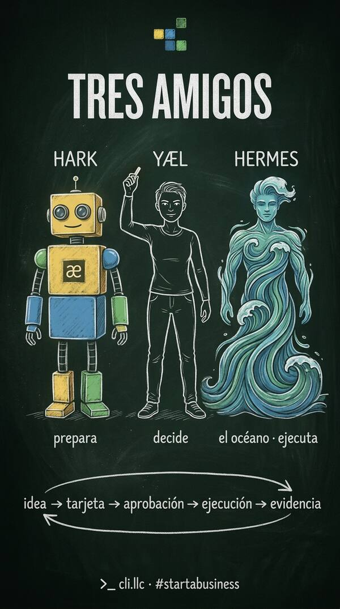

# >_ cli.llc · hark-studio

[](assets/tres-amigos.mp4)

▶ [Video 9:16 · tres-amigos.mp4](assets/tres-amigos.mp4)

**#startabusiness** empieza aquí: cli.llc es la marca y la capa de ejecución.

**Tres amigos: Yæl decide · Hark prepara · Hermes ejecuta.**
*Evidence ≠ Authority: supervision informs, the human decides.*

`æ://cli.llc` es el taller compartido entre Yæl Méndez, Hark y Hermes Agent (el océano).
Aquí las ideas se vuelven tarjetas, las tarjetas se vuelven trabajo, y el trabajo deja evidencia.

> **Fuente única de verdad.** Si no está aquí, no pasó. Ver `AGENTS.md` y `STATE.md`.

---

## El loop

```
idea → tarjeta → aprobación → ejecución → evidencia → decisión
 Yæl     Hark       Yæl         Hermes      Kanban       Yæl
```

| Rol | Quién | Qué hace |
|---|---|---|
| Principal | Yæl | Decide, aprueba, firma |
| Preparador | Hark | Investiga, redacta tarjetas, comandos y PRs |
| Ejecutor | Hermes (droplet) | Corre el trabajo aprobado |
| Memoria | Hermes Kanban | Guarda estado y evidencia |

Estados del tablero: `triage → todo → ready → running → blocked → review → done → archived`

Regla: toda tarea con riesgo (dinero, borrar, publicar, secretos, shell) espera aprobación humana en `review`.

---

## Mapa del sistema

- **cli.llc**: execution layer
- **æ**: capability / homebase ([myaelmendez.github.io](https://myaelmendez.github.io))
- **#startabusiness**: user journey (formación con doola)
- **CRI / EAI**: measurement layer
- **droplet**: broker CUDA-MCP² + Hermes API (detrás de nginx)
- **Victus RTX 3050**: hoja GPU vía túnel inverso

---

## Estructura

```
hark-studio/
├── README.md        este archivo
├── AGENTS.md        reglas para todo agente
├── STATE.md         estado vivo del tablero
├── cards/           tarjetas de trabajo (una por archivo, .md)
├── evidence/        recibos, logs y capturas de cada tarjeta
├── skills/          skills reutilizables para Hark y Hermes
└── decisions/       registro de decisiones de Yæl
```

---

## Primeras tarjetas

- [ ] [`cards/001-hermes-api-droplet.md`](cards/001-hermes-api-droplet.md): Hermes API Server detrás de nginx + TLS, `/health` y `/v1/capabilities`
- [ ] [`cards/002-doola-iframe.md`](cards/002-doola-iframe.md): iFrame de doola en `/startabusiness` con el link de PartnerStack como respaldo
- [ ] [`cards/003-rtx-tunnel.md`](cards/003-rtx-tunnel.md): levantar el túnel Victus → droplet y volver a hornear `droplet.html`
- [ ] [`cards/004-eai-spec.md`](cards/004-eai-spec.md): EAI v0.1 (ocho dimensiones, evidencia observable)
- [ ] [`cards/005-repo-weight.md`](cards/005-repo-weight.md): mover MP4 grandes del github.io a Releases/CDN

---

#opensourceware · #startabusiness · #internetofagents · >_æææ://
